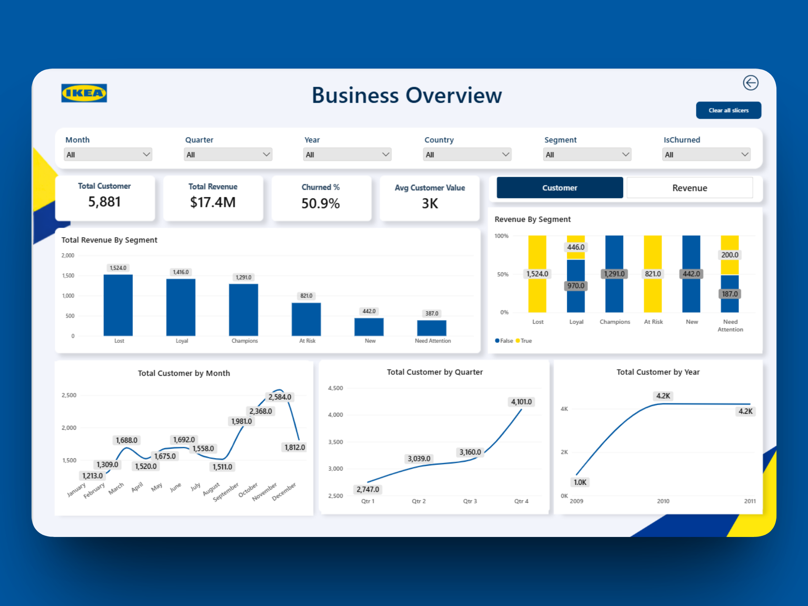
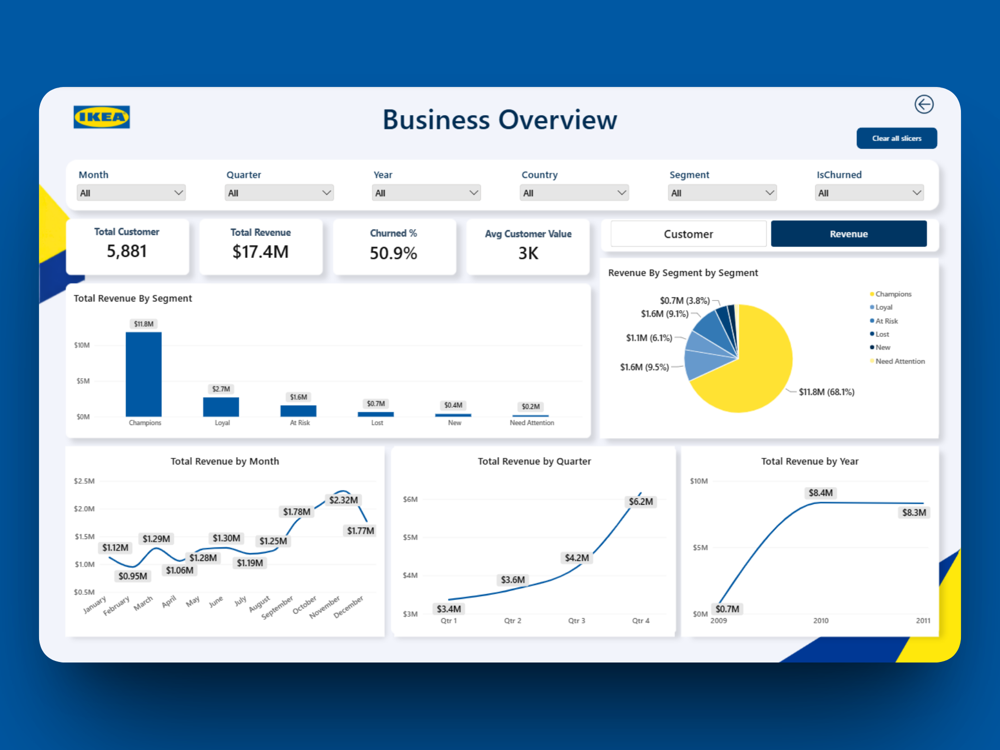
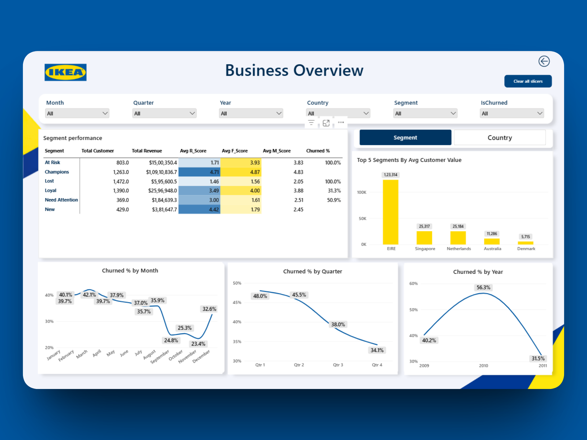
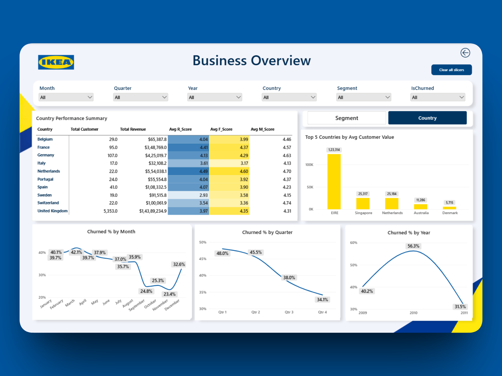

# Customer Churn & RFM Segmentation: SQL, Python and Power BI

**Which customers are most valuable, and which are about to leave?**
An end-to-end analytics project that takes 1M+ raw wholesale transactions through SQL cleaning, Python segmentation and an interactive Power BI dashboard.


**Author:** Yasir Sheikh | Aspiring Data Analyst / BI Analyst



> **Disclaimer:** "IKEA Gifting" is a fictional brand name used only for this educational portfolio project. It is not affiliated with or endorsed by the real IKEA. All figures come from a public, anonymised retail dataset and do not reflect any real company's performance. The dashboard branding is for design and storytelling purposes only.

---

## At a Glance

| | |
|---|---|
| **Scenario** | A UK online wholesale gifting and home décor brand (fictional) selling to bulk buyers |
| **Problem** | Leadership had no structured view of customer value, so retention efforts were reactive instead of targeted |
| **What I built** | A cleaned SQL dataset, a Python RFM and churn model, and a multi-page Power BI dashboard |
| **Result** | 5,881 customers sorted into 6 segments, with a prioritised win-back list |

---

## Headline Results

| Metric | Value |
|---|---|
| Customers analysed | **5,881** |
| Total revenue | **$17.4M** |
| Churn rate (no order in 90+ days) | **50.9%** |
| Revenue from Champions (about 22% of customers) | **68.1%** |
| "At Risk" customers to win back | **823** (about $1.6M in past revenue) |

---

## My Approach

I worked backwards from the business decision rather than from the dataset. Before touching any data, I wrote down the questions the analysis had to answer, and every technical step traces back to one of them.

### Business Questions Answered

| # | Question | Where answered |
|---|---|---|
| 1 | Who are our most valuable customers, and how much revenue do they contribute? | Segment performance table |
| 2 | Which customers have gone quiet and are at risk of churning? | Churn flag and "At Risk" segment |
| 3 | How do customer value and retention change over time? | Month, quarter and year trend charts |
| 4 | How do value and churn differ across countries? | Country performance view |
| 5 | What action should the business take for each segment? | Recommendations below |

### Real Data Problems I Had to Solve

I used the raw data rather than a pre-cleaned version, so the project includes genuine quality issues:

| Problem | How I handled it |
|---|---|
| Mixed date formats across rows | `COALESCE` with two `TRY_CONVERT` styles, so no rows were dropped |
| Invalid price and type values | `TRY_CONVERT` to `DECIMAL`, plus a count of failed conversions |
| Missing customer IDs (guest checkouts) | Quantified, then excluded from customer-level analysis |
| Returns and cancellations (negative quantity) | Identified, then excluded from RFM and revenue |
| Exact duplicate transactions | Removed with `ROW_NUMBER()` in a CTE |

---

## 1. Tech Stack
 
| Layer | Tool | Purpose |
|---|---|---|
| Data engineering | Microsoft SQL Server, SSMS | Ingestion, type casting, union, exploration, deduplication |
| Analysis & modelling | Python (Jupyter, Pandas) | RFM metrics, quintile scoring, segmentation, churn flag |
| Visualisation | Power BI Desktop, DAX | KPI measures, interactive multi-page dashboard |
 
---
 
## 2. Pipeline Architecture
 
```
Raw data (2 files, 1M+ rows)
        │
        ▼
[SQL Server / SSMS]   Ingestion → Type casting → UNION ALL → EDA → Deduplication (ROW_NUMBER)
        │
        ▼   Export: RetailCleaned.csv
[Python / Jupyter]    RFM metrics → Quintile scoring (1–5) → Segment rules → Churn flag
        │
        ▼   Export: ECommerceDashboardData.xlsx
[Power BI Desktop]    Data model → DAX measures → Bookmarks → Interactive drill-downs
```
 
---
 
## 3. Step 1: Data Engineering in SQL Server
 
**Script:** [`sql/data_cleaning.sql`](sql/data_cleaning.sql)
 
| Task | Approach |
|---|---|
| Import | Loaded both annual files via the SSMS Flat File Import wizard; overrode auto-detected types (e.g. `Quantity` to INT, `Price` to DECIMAL) |
| Row-count validation | `COUNT(*)` on each source table after import |
| Combine years | `UNION ALL` into `dbo.RetailCombined`, with a `SourceSheet` column to preserve lineage |
| Safe type conversion | `COALESCE(TRY_CONVERT(..., 120), TRY_CONVERT(..., 105))` normalises inconsistent date formats without dropping rows; `TRY_CONVERT(decimal(10,2), Price)` for prices |
| Conversion audit | Counted rows where date or price conversion returned `NULL` |
| Data exploration | Missing `Customer_ID`, non-positive `Quantity`, missing `Description`, exact duplicate rows |
| Deduplication | `ROW_NUMBER() OVER (PARTITION BY <all columns> ORDER BY (SELECT NULL))` in a CTE, keeping `RowNum = 1`, saved to `dbo.RetailCleaned` |
 
**Why SQL for this stage:** the engine handles 1M+ rows without consuming local RAM, and window functions allow precise deduplication that preserves the first instance of each transaction.
 
---
 
## 3. Step 2: RFM & Churn Modelling in Python
 
**Notebook:** [`notebooks/rfm_segmentation.ipynb`](notebooks/rfm_segmentation.ipynb)
 
### 4.1 Preparation
 
- Loaded `RetailCleaned.csv` and parsed `InvoiceDate` as a datetime.
- Excluded rows with missing `Customer_ID` and rows with `Quantity <= 0`, so the analysis covers confirmed, revenue-generating sales only.
- Set the **snapshot date to 2011-12-10** (one day after the last recorded order) as the reference point for recency.
### 4.2 RFM Metrics
 
| Metric | Definition | Pandas logic |
|---|---|---|
| **Recency (R)** | Days since the customer's last order | `snapshot_date - InvoiceDate.max()` |
| **Frequency (F)** | Number of distinct orders | `Invoice.nunique()` |
| **Monetary (M)** | Total revenue contributed | `sum(Quantity × Price)` |
 
### 4.3 Scoring
 
Each metric is divided into quintiles using `pd.qcut` and scored 1–5. Recency is scored in reverse, so recent buyers receive the highest score. Frequency is ranked (`method='first'`) before binning to handle heavily tied values.
 
### 4.4 Segmentation Rules
 
Rules are evaluated in the order shown.
 
| Order | Segment | Rule | Interpretation |
|---|---|---|---|
| 1 | **Champions** | R ≥ 4, F ≥ 4, M ≥ 4 | Recent, frequent, high-spending buyers |
| 2 | **Loyal** | R ≥ 3, F ≥ 3 | Consistent, repeat buyers |
| 3 | **At Risk** | R ≤ 2, F ≥ 3 | Previously frequent, now inactive |
| 4 | **New** | R ≥ 4, F ≤ 2 | Recent buyers with few orders |
| 5 | **Need Attention** | R = 3, F ≤ 2 | Mid-recency, low frequency |
| 6 | **Lost** | All remaining | Inactive and low engagement |
 
### 4.5 Churn Definition
 
```python
rfm['IsChurned'] = rfm['Recency'] > 90   # inactive for more than 90 days
```
 
### 4.6 Resulting Segment Distribution
 
| Segment | Customers |
|---|---:|
| Lost | 1,529 |
| Loyal | 1,416 |
| Champions | 1,289 |
| At Risk | 823 |
| New | 442 |
| Need Attention | 382 |
| **Total** | **5,881** |
 
The RFM output is merged back onto the transaction table (adding `InvoiceMonth` and `Revenue`) and exported for Power BI.
 
**Why Python for this stage:** quantile bucketing, multi-condition labelling and scoring are cleaner and faster to iterate in Pandas than in SQL.
 
---
 
## 5. Step 3: Power BI Dashboard
 
### 5.1 Core DAX Measures
 
| Measure | DAX |
|---|---|
| Total Revenue | `SUM(Retail[Revenue])` |
| Total Customers | `DISTINCTCOUNT(Retail[Customer_ID])` |
| Churn Rate (%) | `DIVIDE(CALCULATE(DISTINCTCOUNT(Retail[Customer_ID]), Retail[is_churn] = TRUE), [Total Customers])` |
| Avg Customer Value (ARPU) | `DIVIDE([Total Revenue], [Total Customers])` |
| Average R / F / M Score | `AVERAGE(Retail[R_Score])`, `AVERAGE(Retail[F_Score])`, `AVERAGE(Retail[M_Score])` |
 
### 5.2 Dashboard Pages
 
| Page | View | Contents |
|---|---|---|
| **Business Overview** | Customer view | Customers by segment (split by churn status) and customer counts by month, quarter and year |
| **Business Overview** | Revenue view | Revenue by segment (bar and pie) and revenue by month, quarter and year |
| **RFM & Churn Deep-Dive** | Segment view | Segment performance matrix with heat-map formatting, plus churn % trends by month, quarter and year |
| **RFM & Churn Deep-Dive** | Country view | Country performance summary and top countries by average customer value |
 
**UX features:** bookmark-driven view toggles (Customer / Revenue and Segment / Country), six global slicers (Month, Quarter, Year, Country, Segment, IsChurned), a "Clear all slicers" button, a consistent branded theme, and a metric glossary page for non-technical stakeholders.
## Dashboard

| Page | Contents |
|---|---|
| **Business Overview** | Headline KPIs (customers, revenue, churn %, average customer value), a Customer / Revenue toggle, segment breakdowns, and month, quarter and year trends |
| **RFM & Churn Deep-Dive** | Segment performance table (customers, revenue, average R/F/M score, churn %), country performance, average customer value rankings, and churn % over time |
| **Glossary** | Plain-language definitions of Recency, Frequency, Monetary and Churned % for non-technical readers |

**Usability features:** filters for Month, Quarter, Year, Country, Segment and Churn status, bookmark-based toggles, and a "Clear all slicers" button.

| Customer view | Revenue view |
|---|---|
|  |  |

| Segment deep-dive | Country deep-dive |
|---|---|
|  |  |

---

## Skills Demonstrated

| Area | Skills |
|---|---|
| **SQL** | `UNION ALL`, CTEs, window functions, `TRY_CONVERT`, `COALESCE`, data quality checks |
| **Python** | Pandas, `groupby` aggregation, quantile scoring (`qcut`), rule-based segmentation |
| **Power BI** | Data modelling, DAX measures, bookmarks, conditional formatting, multi-page design |
| **Analytics** | RFM analysis, churn definition, customer segmentation, KPI design |
| **Communication** | Business requirements, plain-English insights, actionable recommendations |

---

## Code Samples

**SQL: handling mixed date formats**

```sql
SELECT
    Invoice, StockCode, Description, Quantity,
    COALESCE(
        TRY_CONVERT(datetime2, InvoiceDate, 120),
        TRY_CONVERT(datetime2, InvoiceDate, 105)
    ) AS InvoiceDate,
    TRY_CONVERT(decimal(10,2), Price) AS Price,
    Customer_ID, Country
INTO dbo.RetailCombined
FROM dbo.[Year 2009-2010];
```

**SQL: removing exact duplicates**

```sql
WITH Deduped AS (
    SELECT *,
           ROW_NUMBER() OVER (
               PARTITION BY Invoice, StockCode, Description, Quantity,
                            InvoiceDate, Price, Customer_ID, Country
               ORDER BY (SELECT NULL)) AS RowNum
    FROM dbo.RetailCombined
)
SELECT * INTO dbo.RetailCleaned FROM Deduped WHERE RowNum = 1;
```

**Python: RFM scoring**

```python
rfm['R_Score'] = pd.qcut(rfm['Recency'], 5, labels=[5, 4, 3, 2, 1]).astype(int)
rfm['F_Score'] = pd.qcut(rfm['Frequency'].rank(method='first'), 5, labels=[1, 2, 3, 4, 5]).astype(int)
rfm['M_Score'] = pd.qcut(rfm['Monetary'], 5, labels=[1, 2, 3, 4, 5]).astype(int)
rfm['IsChurned'] = rfm['Recency'] > 90
```

<details>
<summary><b>Segmentation rules and DAX measures (click to expand)</b></summary>

### Segmentation Rules (applied in this order)

| Segment | Rule (scores 1 to 5) | Customers |
|---|---|---:|
| Champions | R ≥ 4, F ≥ 4, M ≥ 4 | 1,289 |
| Loyal | R ≥ 3, F ≥ 3 | 1,416 |
| At Risk | R ≤ 2, F ≥ 3 | 823 |
| New | R ≥ 4, F ≤ 2 | 442 |
| Need Attention | R = 3, F ≤ 2 | 382 |
| Lost | Everyone else | 1,529 |

### Metric Definitions

| Metric | Definition |
|---|---|
| Recency | Days between the snapshot date (2011-12-10) and the last order |
| Frequency | Number of distinct invoices |
| Monetary | Sum of `Quantity × Price` |
| Churn | Recency greater than 90 days |

### Core DAX Measures

```DAX
Total Revenue      = SUM(Retail[Revenue])
Total Customers    = DISTINCTCOUNT(Retail[Customer_ID])
Churn Rate (%)     = DIVIDE(
                       CALCULATE(DISTINCTCOUNT(Retail[Customer_ID]), Retail[is_churn] = TRUE),
                       [Total Customers])
Avg Customer Value = DIVIDE([Total Revenue], [Total Customers])
```

### Limitations

- The 90-day churn rule is fixed; real buying cycles vary by customer.
- Churn is measured at one snapshot date, so earlier periods naturally show more churn.
- Score cut-offs are relative to this dataset.

</details>

---

## Data Source

**Online Retail II**, UCI Machine Learning Repository, donated by Daqing Chen. A real, anonymised transactional dataset from a UK-based online retailer of gift-ware, covering December 2009 to December 2011 with 1,067,371 raw rows across two sheets. Licensed under CC BY 4.0.

## Repository Structure

```
├── 01_sql/         data cleaning scripts
├── 02_python/      rfm_segmentation.ipynb
├── 03_powerbi/     dashboard (.pbix)
├── images/         dashboard screenshots
└── README.md
```


## Next Steps

- Predictive churn model (logistic regression or gradient boosting)
- Customer lifetime value (CLV) estimation
- Cohort retention analysis

